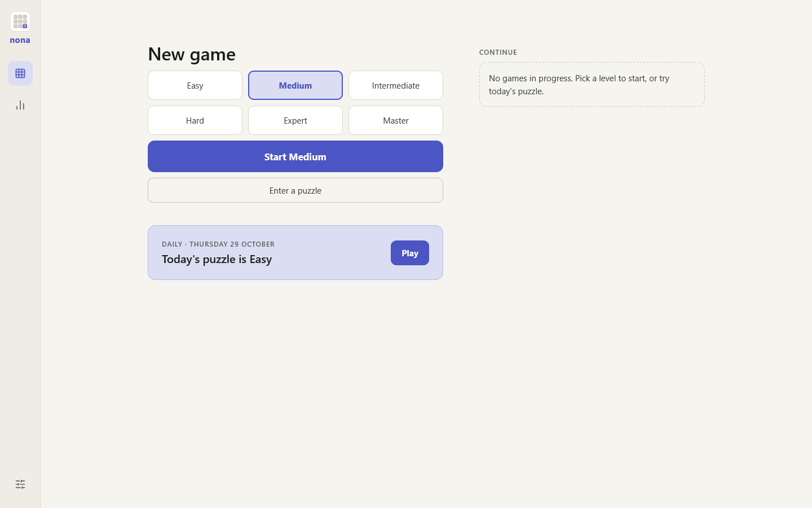
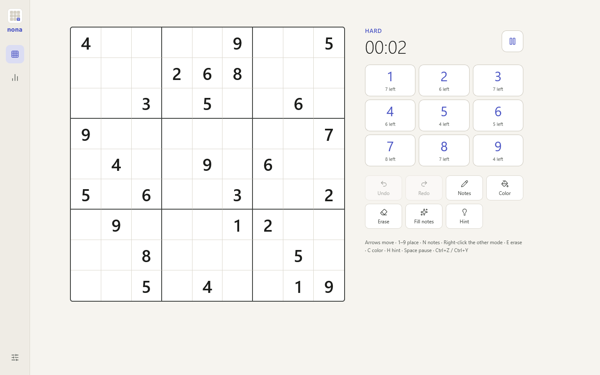
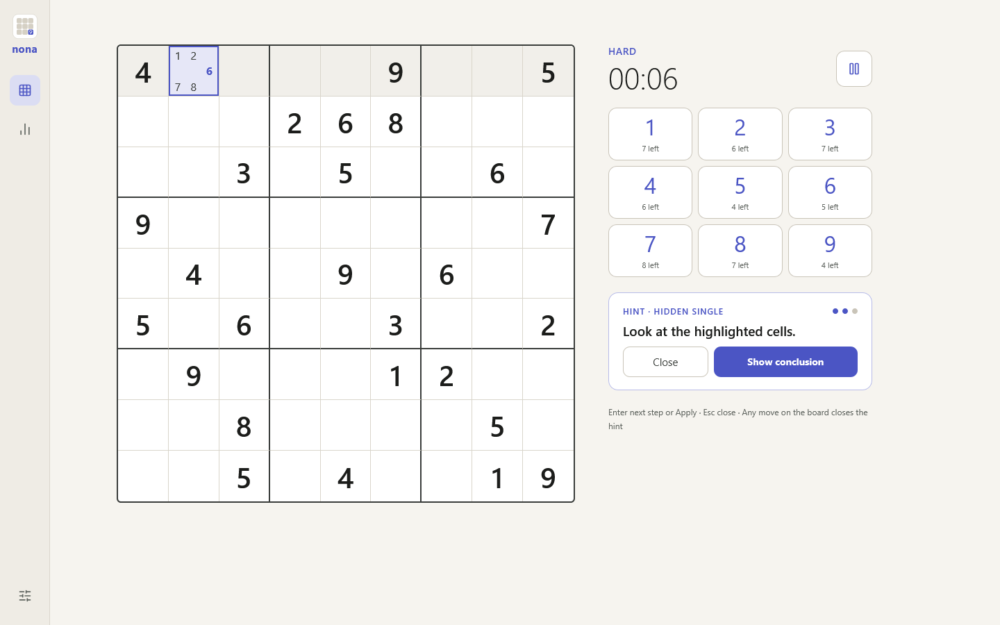
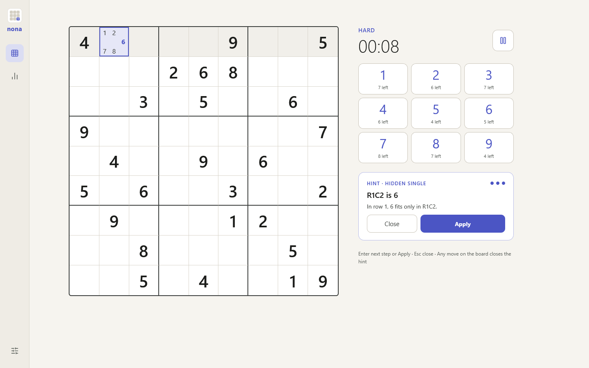
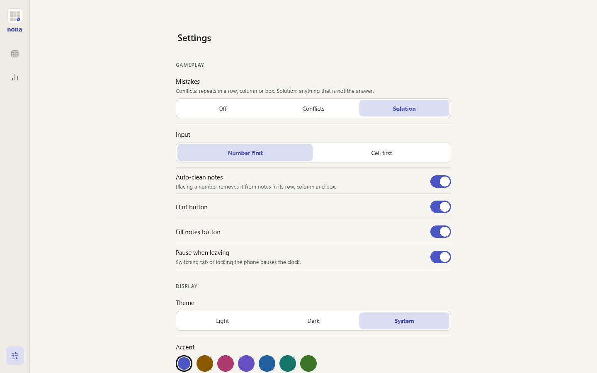
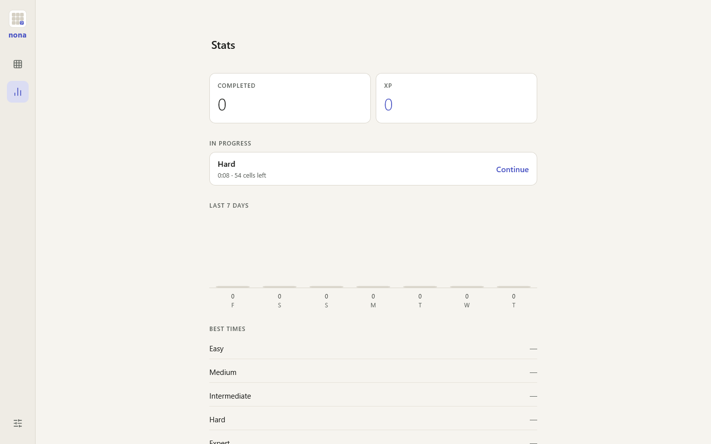

# nona guide

How to play nona and use its hints. The [README](../../README.md) lists everything the app does; this page is a short walk through.

Open https://memoriainfinita.github.io/nona/. Everything stays in your browser: there is no account, and nothing is uploaded.

## Start a game

Pick a level, from Easy to Master, and press **Start**. «Enter a puzzle» lets you type one of your own, and the daily puzzle is the same for everyone and changes at midnight UTC. Games in progress wait under **Continue**.

## Play

- **Number first:** tap a number to fix it, then the cells. Tap it again for notes, a third time to let it go
- **Cell first:** tap the cell, then the number. You can switch the input mode in Settings
- Right-click writes in the other notes mode
- The keyboard: arrows move, `1`–`9` place, `N` notes, `E` erase, `C` colour, `H` hint, Space pause, `Ctrl+Z` and `Ctrl+Y` undo and redo
- Notes clean themselves when you place a number; **Fill notes** and **Clear notes** do it for the whole board

## Ask for a hint

Press `H`, or the hint button. A hint comes in three steps, so you can stop when you have learned enough:

1. **The technique** — here a *Hidden single* — and where to look
2. **The cells involved**, highlighted on the board
3. **The conclusion**, with its explanation, and **Apply** to place it

`Enter` goes to the next step or applies the hint, and `Esc` closes it. If some of the numbers on the board do not match the solution, the hint marks them and offers to remove them before the next step.

## Stats and settings

- **Stats** shows your completed games, XP, the last seven days, your best times without hints and the history; open a game there to see the solved board and play it again
- **Settings** has, under Gameplay, how mistakes show (Off, Conflicts or Solution), the input mode, auto-clean notes, the hint and fill-notes buttons and pausing when you leave; under Display, the theme, the accent and the number size; and the backup: **Export** saves a JSON file and **Import** restores it, merging or replacing

## Install it

nona can be installed: Chrome and Edge offer it in the address bar or the menu; on Android, Firefox adds it to the home screen, and so does Safari on iPhone.
